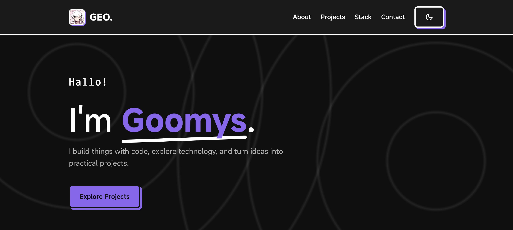
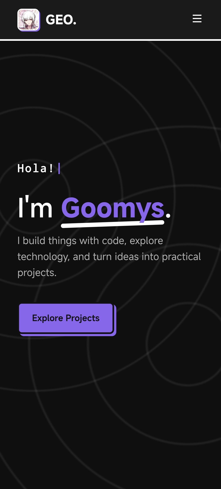

<div align="center">

# Goomys Portfolio

**A developer specializing in automation, web apps, and Minecraft mods.**

[](https://goomys.biz.id)


</div>

---

## Table of Contents

- [Preview](#preview)
- [Features](#features)
- [Tech Stack](#tech-stack)
- [Project Structure](#project-structure)
- [Getting Started](#getting-started)
- [Customization](#customization)
- [Deployment](#deployment)
- [Contact](#contact)
- [License](#license)

---

## Preview

**Live Demo:** [goomys.biz.id](https://goomys.biz.id)

| Desktop | Mobile |
| :-----: | :----: |
|  |  |

---

## Features

- **Neo-Brutalism design** — bold borders and hard shadows
- **Light & Dark mode** — with smooth transitions
- **Smooth scrolling** — powered by Lenis
- **Multilingual typing effect** — cycles through 10 languages
- **Scroll reveal animations**
- **Interactive "press" effect** on buttons
- **Fully responsive** — works on desktop, tablet, and mobile
- **Modular project data** — projects are kept in a separate JS module

---

## Tech Stack

**Frontend**

- HTML5
- CSS3 (Vanilla)
- JavaScript ES6+ (Modules)
- [Lenis](https://github.com/darkroomengineering/lenis) — smooth scroll library

**Backend & Deployment**

- Python (Flask) — static file serving
- Vercel — hosting & CI/CD

---

## Project Structure

```text
GoomysPortfolio/
├── app.py              # Flask app (serves static files)
├── requirements.txt    # Python dependencies
├── vercel.json         # Vercel configuration
├── README.md
├── screenshots/        # Preview images used in this README
└── static/
    ├── index.html
    ├── css/
    │   └── style.css
    ├── js/
    │   ├── main.js     # UI logic, animations, typing effect
    │   └── projects.js # Project data
    └── assets/
        └── profile.jpg
```

---

## Getting Started

### Prerequisites

- [Python 3](https://www.python.org/downloads/)
- [Git](https://git-scm.com/)

### Installation

1. **Clone the repository**

   ```bash
   git clone https://github.com/geoffreyoner/GoomysPortfolio.git
   cd GoomysPortfolio
   ```

2. **(Optional) Create a virtual environment**

   ```bash
   python -m venv venv

   # macOS / Linux
   source venv/bin/activate

   # Windows
   venv\Scripts\activate
   ```

3. **Install dependencies**

   ```bash
   pip install -r requirements.txt
   ```

4. **Run the Flask app**

   ```bash
   python app.py
   ```

5. **Open in your browser**

   ```text
   http://localhost:5000
   ```

---

## Customization

- **Projects** — edit `static/js/projects.js` to add, remove, or update the projects shown on the page.
- **Styling** — colors, borders, and shadows live in `static/css/style.css`.
- **Profile photo** — replace `static/assets/profile.jpg` with your own image.

---

## Deployment

This project is deployed on [Vercel](https://vercel.com/). To deploy your own copy:

1. Fork or clone this repository.
2. Import it into Vercel.
3. Vercel picks up the settings from `vercel.json` and deploys automatically on every push.

---

## Contact

| Platform  | Handle |
| --------- | ------ |
| GitHub    | [@geoffreyoner](https://github.com/geoffreyoner) |
| Instagram | [@gxmysz](https://instagram.com/gxmysz) |
| TikTok    | [@bayyyqt](https://tiktok.com/@bayyyqt) |
| Telegram  | [@gloomygkvhl](https://t.me/gloomygkvhl) |

---

## License

Distributed under the [MIT License](LICENSE).

---

<div align="center">

Made with ❤️ by **Goomys**

</div>
